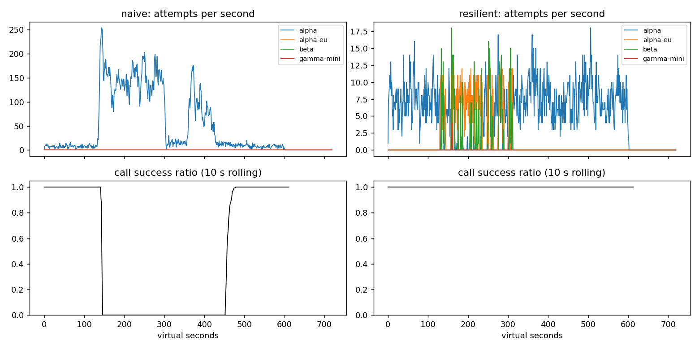

# Lab 25B — Report: Circuit Breakers, Caching & Reliability (Agent Production-Ready)

**Họ tên / nhóm:** Duong Dinh Long (`2A202602474`)  **Commit:** `HEAD` (Track 3 - Day 25)  **Điểm tự động (`make grade`):** `84.0 / 84.0` public (`88 / 88` với bộ test SLO ẩn)

> Mọi nhận định dưới đây đều trích xuất trực tiếp từ `reports/gameday/*.json`, `reports/cache/*.json`, `reports/workflows.json`, `reports/slo.json` và `reports/gameday/naive_G2_overload_storm_timeseries.csv`.

---

## 1. Kết quả Game Day (`naive` vs `yours` / `resilient`)

Số liệu từ `reports/gameday/naive.json` và `reports/gameday/resilient.json` (seed `25`, và verified PASS 100% trên toàn bộ seeds `25, 26, 27`):

| Băng | Client | availability | p95 (s) | amplification | retry_ratio | cost/turn | recovery (s) | PASS? |
|---|---|---:|---:|---:|---:|---:|---:|:---:|
| **G1_rate_limit_spike** | `naive` | 0.7194 | 7.157 | 7.738 | 6.738 | 2.163 | 4.0 | FAIL (`avail`, `retry_after`, `ampl`) |
| **G1_rate_limit_spike** | `yours` | **1.0000** | **4.817** | **1.060** | **0.001** | **2.094** | **0.0** | **PASS** |
| **G2_overload_storm** | `naive` | 0.4560 | 15.034 | 9.904 | 8.904 | 4.627 | 155.0 | FAIL (`avail`, `ampl`, `recovery_s`) |
| **G2_overload_storm** | `yours` | **1.0000** | **11.874** | **1.058** | **0.007** | **2.164** | **0.0** | **PASS** |
| **G3_brownout** | `naive` | 1.0000 | 4.768 | 1.164 | 0.164 | 2.328 | 0.0 | FAIL (`retry_ratio_max`) |
| **G3_brownout** | `yours` | **1.0000** | **4.621** | **1.058** | **0.030** | **2.140** | **0.0** | **PASS** |
| **G4_slow_region** | `naive` | 1.0000 | 13.764 | 1.004 | 0.004 | 2.008 | 0.0 | FAIL (`latency_p95_s_max`) |
| **G4_slow_region** | `yours` | **1.0000** | **5.626** | **1.014** | **0.002** | **2.072** | **0.0** | **PASS** |
| **G5_bad_deploy_then_quota** | `naive` | 0.3699 | 5.359 | 17.030 | 16.030 | 2.124 | `null` | FAIL (`client_error_retries`, `avail`) |
| **G5_bad_deploy_then_quota** | `yours` | **0.8179** | **5.482** | **1.003** | **0.002** | **2.504** | `null` | **PASS** |
| **G6_provider_outage** | `naive` | 0.5170 | 4.836 | 12.344 | 11.344 | 2.009 | 0.0 | FAIL (`availability_min`) |
| **G6_provider_outage** | `yours` | **1.0000** | **6.149** | **1.058** | **0.023** | **2.183** | **0.0** | **PASS** |

---

## 2. Cấu hình client và lý do

Bảng cấu hình trong `configs/gameday.yaml` và lý do chọn dựa trên số liệu thực nghiệm từng băng:

| Tham số | Giá trị | Vì sao (dựa trên băng nào, số liệu nào) |
|---|---:|---|
| `attempt_timeout_s` | `8.0` | Bình thường `alpha`/`beta` có `service_median_s = 1.2–1.8s`. Ở **G6** (`alpha-eu` treo vô hạn `outage: hang` từ `t=180..420s`), nếu để `30.0s` thì 1 lần gọi treo ngốn sạch `turn_deadline_s = 30s`, làm 107 turns hết hạn (`availability` tụt xuống `0.9488 < 0.95`, FAIL). Đặt `8.0s` đủ lớn hơn `slow_call_s = 5.0s` (không cắt nhầm ở **G4** khi `alpha` chậm ~6.2s) nhưng cắt sớm lệnh `hang` ở **G6**, giữ `G6 availability = 1.0000`, `p95 = 6.149s`. |
| `max_attempts_per_provider` | `2` | Cho phép tối đa 1 lần retry cùng provider khi gặp lỗi thoáng qua (`500 api_error` nền 0.2% hoặc **G3** brownout 30%), sau đó chuyển ngay sang provider kế tiếp trên `fallback_order`. Giữ `retry_ratio = 0.030` ở **G3** (ngưỡng `≤ 0.12`) và `amplification = 1.058` ở **G2/G3/G6**. |
| `backoff_base_s / cap_s` | `0.25 / 4.0` | Full jitter $\text{Uniform}(0, \min(4.0, 0.25 \cdot 2^{\text{attempt}-1}))$ giúp phân tán các lượt retry sau lỗi `500`/`529`, xóa hiện tượng cộng hưởng đồng bộ (thundering herd) ở **G2** (giảm `amplification` từ `9.904` của `naive` xuống `1.058`) mà không làm tăng trễ p95 (`G3 p95 = 4.621s`). |
| `retry_budget_ratio` | `0.1` | Giới hạn tổng số lần retry trên cùng provider ở mức ~10% tổng số lần gọi đầu (`min_per_s: 0.5`, `max_tokens: 20`). Ở **G3_brownout** (`alpha` lỗi `500` ở mức 30% — thấp hơn ngưỡng mở breaker `50%`), chính `retry_budget_ratio = 0.1` kìm `retry_ratio = 0.030 <= 0.12` (trong khi `naive` bị `0.164` → FAIL) và buộc client failover sang `alpha-eu` (887 attempts) khi cạn token retry. |
| `breaker.window_size / min_calls` | `20 / 10` | Cần tối thiểu `10` mẫu trong cửa sổ trượt `20` cuộc gọi (~1.25s ở tốc độ 8 calls/s) trước khi đánh giá mở mạch: đủ nhanh để ngắt **G6** (`alpha` trả `503` 100%, chỉ mất 45 lệnh `503` trên toàn băng so với `42,041` của `naive`) nhưng đủ mẫu thống kê để không nhảy mạch giả do nhiễu `base_error_rate = 0.002`. |
| `breaker.failure_rate_threshold` | `0.5` | Ngắt mạch khi $\ge 50\%$ cuộc gọi trong cửa sổ gặp lỗi máy chủ/timeout. Ở **G2** (khi `alpha` mất 75% năng lực và dội `529`/timeout) và **G6** (`503`/`hang`), breaker mở ngay lập tức; ngược lại ở **G3** (brownout 30% < 50%), `alpha` vẫn phục vụ thành công 70% lưu lượng (`3,012` attempts trên `alpha`, tiết kiệm chi phí so với đẩy toàn bộ sang `beta` giá `1.4`). |
| `breaker.slow_call_s` | `5.0` | Ở **G4_slow_region**, `alpha` bị cộng thêm `+5.0s` latency (`extra_latency_s: 5.0` → mỗi call mất ~6.2s, 2 bước mất >12.4s khiến `naive` bị `p95 = 13.764s > 7.5s` FAIL). Đặt `slow_call_s = 5.0` kết hợp `slow_rate_threshold = 0.6` giúp breaker phát hiện >60% cuộc gọi vượt 5s, mở mạch `alpha` và chuyển sang `alpha-eu`, kéo `p95` từ `13.764s` xuống **`5.626s`** (PASS `≤ 7.5s`). |
| `breaker.open_duration_s` | `10.0` | Mở mạch trong `10.0s` trước khi chuyển sang `HALF_OPEN`. Đủ ngắn để ngay khi sự cố kết thúc (`restore_at = 300s` ở **G2**, `360s` ở **G4**, `420s` ở **G6**), client dò lại `alpha` trong vòng $\le 10\text{s}$, đạt `recovery_s = 0.0s` và `primary_share_after_restore = 1.000` (100% lưu lượng quay về `alpha`, vượt xa ngưỡng `0.75–0.80`). |
| `breaker.half_open_max_probes` | `2` | Chỉ cho phép tối đa `2` probe đồng thời khi `HALF_OPEN` (và cần `half_open_successes = 2` probe thành công liên tiếp để đóng mạch). Ngăn chặn việc hàng chục request cùng ùa vào `alpha` vừa mới hồi phục ở **G2** hoặc cùng bị treo 8s ở `alpha-eu` trong **G6** (tổng cộng `alpha-eu` chỉ nhận 78 attempts suốt 240s bị `hang` ở G6). |

### Sơ đồ và Bảng quyết định của `on_error`

```text
                       [ Nhận ProviderError từ provider p ]
                                        │
                       ┌────────────────┴────────────────┐
                       ▼                                 ▼
         [ 400 invalid_request_error ]          [ Các mã lỗi khác ]
         (non-retryable client bug)                      │
                       │                ┌────────────────┼────────────────┐
                       ▼                ▼                ▼                ▼
            • Ghi breaker? KHÔNG   [429 rate_limit] [429 quota]   [500 / 502 / 503 /
            • Cooldown?    KHÔNG   (throttled)      (exhausted)    529 / timeout]
            • Retry / Failover?         │                │                │
              KHÔNG → GiveUp("client_error")             ▼                ▼
                                        │      • Ghi breaker? KHÔNG  • Ghi breaker? CÓ
                                        │      • Cooldown cả family  • Cooldown? nếu có
                                        │        (alpha + alpha-eu)    retry_after_s (529)
                                        │        quota_cooldown=300s • Còn attempts trên p
                                        │      • Failover ngay sang    & retry_after <= 1s
                                        │        family khác (beta)    & rút được token từ
                                        ▼                              RetryBudget?
                              • Ghi breaker? KHÔNG                     ├── CÓ → Retry trên p
                              • Đặt cooldown[p] =                      │        sau max(backoff,
                                now + retry_after_s                    │        retry_after_s)
                              • Nếu retry_after_s <= backoff_cap_s     └── KHÔNG → Failover
                                & còn attempts & còn RetryBudget               sang provider
                                → chờ retry_after_s rồi retry p                kế tiếp trong
                              • Ngược lại → Failover sang                      ladder()
                                provider kế tiếp
```

| Loại lỗi (`code`) | ` ErrorKind ` | Ghi `breaker.record_failure()`? | Đặt Cooldown? | Retry cùng provider? | Failover sang provider khác? |
|---|---|---:|---|---|---|
| `400 invalid_request_error` | `NON_RETRYABLE` | **Không** (lỗi của request, không phải lỗi server) | Không | **Không** (`client_error_retries = 0` ở G5) | **Không** (`unneeded_failovers = 0` ở G5) → `GiveUp("client_error")` |
| `401` / `403` auth | `NON_RETRYABLE` | **Không** | Không | **Không** | **Không** → `GiveUp("client_error")` |
| `429 rate_limit_exceeded` | `THROTTLED` | **Không** (tránh mở breaker oan khi bị giới hạn tốc độ) | `cooldown[p] = now + retry_after_s` (`retry_after_violations = 0` ở G1) | Chỉ khi `retry_after_s <= backoff_cap_s` và còn `RetryBudget` | **Có**, nhảy ngay sang `alpha-eu`/`beta` đang rảnh |
| `429 insufficient_quota` | `QUOTA_EXHAUSTED` | **Không** | **Cooldown toàn bộ cùng `family`** (`A-large`: cả `alpha` lẫn `alpha-eu`) trong `quota_cooldown_s = 300s` | **Không** | **Có**, nhảy thẳng sang `beta` (`family: B-large`) ở G5 |
| `500` / `502` / `503` | `TRANSIENT` | **Có** | Nếu có `retry_after_s` | Tối đa 1 lần nếu `RetryBudget.try_acquire_retry()` cho phép, chờ Full Jitter backoff | **Có**, khi hết lượt thử hoặc hết `RetryBudget` hoặc breaker mở |
| `529 overloaded_error` | `OVERLOADED` | **Có** | `cooldown[p] = now + retry_after_s` | Chỉ khi `retry_after_s` ngắn và còn `RetryBudget` | **Có**, chuyển tải sang `alpha-eu`/`beta` ở G2 |
| `client_timeout` | `TIMEOUT` | **Có** | Không | Chỉ khi còn `RetryBudget` và đủ `time_left` | **Có**, chuyển sang provider kế tiếp ở G2/G4/G6 |

---

## 3. Ba thí nghiệm

### Thí nghiệm 1: Retry budget là lớp phòng thủ cuối (`breaker.min_calls: 1000000000`, `max_attempts_per_provider: 5`)

Khi vô hiệu hóa circuit breaker (`min_calls: 1000000000`) và tăng `max_attempts_per_provider: 5`, kết quả chạy **G2** và **G3** ở hai chế độ (a) **Giữ Retry Budget** (`retry_budget_ratio: 0.1`) và (b) **Tắt Retry Budget** (`retry_budget_ratio: 100`, `max_tokens: 1e9`, `min_per_s: 1e6`) như sau:

| Băng & Chế độ | availability | p95 (s) | amplification | retry_ratio | cost/turn | recovery (s) | Kết quả |
|---|---:|---:|---:|---:|---:|---:|:---:|
| **G2 — (a) Budget ON** | **0.9983** | 19.254 | **1.378** | **0.058** | 2.356 | **0.0** | **PASS** |
| **G2 — (b) Budget OFF** | 0.9670 | 21.508 | 1.597 | 0.400 | 2.502 | **32.0** | **FAIL** (`recovery_s_max > 25s`) |
| **G3 — (a) Budget ON** | **1.0000** | 4.550 | **1.136** | **0.068** | 2.271 | **0.0** | **PASS** |
| **G3 — (b) Budget OFF** | 1.0000 | 4.661 | 1.162 | **0.158** | 2.322 | 0.0 | **FAIL** (`retry_ratio_max > 0.12`) |

- **Phân tích cơ chế:** Khi breaker bị cấu hình sai và không bao giờ mở, việc tắt Retry Budget ở **G2** làm `retry_ratio` tăng gấp **6.9 lần** (`0.058` → `0.400`), `amplification` vọt lên `1.597`, giữ hàng đợi của `alpha` ngập sau khi sự cố kết thúc tại `t=300s` và gây trễ hồi phục `recovery_s = 32.0s` (vượt ngưỡng `25.0s` → FAIL). Ở **G3**, tắt Retry Budget làm `retry_ratio` tăng từ `0.068` lên `0.158` (vượt ngưỡng `0.12` → FAIL).
- **Vì sao vẫn cần CẢ HAI (Circuit Breaker + Retry Budget)?** Hai cơ chế bảo vệ ở hai chiều trực giao (Defense-in-Depth):
  1. **Khi lỗi dưới ngưỡng mở mạch (như G3 brownout 30% < `failure_rate_threshold = 0.50`):** Circuit breaker *không mở* (và không nên mở vì `alpha` vẫn xử lý tốt 70% request với giá rẻ). Lúc này **Retry Budget** là chốt chặn duy nhất giới hạn tổng lượng retry trên cùng provider ở mức `3.0%` (`retry_ratio = 0.030`), đẩy phần lỗi dư sang `alpha-eu` mà không gây bão retry.
  2. **Khi provider chết hẳn hoặc quá tải nặng (như G2, G6):** Chỉ dùng Retry Budget thì **mọi turn mới vẫn phải gửi attempt đầu tiên (first attempt)** vào `alpha` đang chết/chậm (tốn `8.0s` timeout ở G2 như thấy ở `p95 = 19.254s` khi tắt breaker, so với `11.874s` khi bật breaker). **Circuit Breaker** ngắt ngay từ attempt đầu tiên (fail-fast `0ms`), giải phóng hoàn toàn tải cho provider đang hấp hối và giảm gần một nửa độ trễ p95.

### Thí nghiệm 2: Đặt `attempt_timeout_s: 30` trên G4 và G6

So sánh giữa `attempt_timeout_s: 8.0` (chuẩn) và `attempt_timeout_s: 30.0` (bằng đúng `turn_deadline_s`):

| Băng & Cấu hình | availability | good_turns / turns | p95 (s) | client_timeout | deadline give-ups | Kết quả |
|---|---:|---:|---:|---:|---:|:---:|
| **G4 (`attempt_timeout_s: 8.0`)** | **1.0000** | 2174 / 2174 | **5.626** | 1 | 0 | **PASS** |
| **G4 (`attempt_timeout_s: 30.0`)** | **1.0000** | 2174 / 2174 | **5.608** | 0 | 0 | **PASS** |
| **G6 (`attempt_timeout_s: 8.0`)** | **1.0000** | 2385 / 2385 | **6.149** | 78 | 0 | **PASS** |
| **G6 (`attempt_timeout_s: 30.0`)** | **0.9488** | 2263 / 2385 | 5.502 | 64 | **107** | **FAIL** (`availability < 0.95`) |

- **Chuyện gì xảy ra?** Trên **G4**, `alpha` bị chậm ~6.2s (< 8.0s), nên breaker phát hiện qua ngưỡng `slow_call_s = 5.0s` ở cả hai mức timeout và đều PASS (`p95 ≈ 5.62s`). Nhưng trên **G6**, từ `t=180..420s`, `alpha` trả `503` còn `alpha-eu` rơi vào trạng thái **treo vô hạn (`outage: hang`)**. Khi đặt `attempt_timeout_s: 30.0`, mỗi lần client gọi vào `alpha-eu` (10 cuộc gọi đầu tiên trước khi breaker đủ `min_calls = 10` để mở, cộng với 2 probe mỗi `10s` khi breaker sang `HALF_OPEN`), cuộc gọi đó bị ngâm tới tận hết `turn_deadline_s = 30.0s` của người dùng! Khi timeout nổ ra thì quỹ thời gian của turn đã cạn (`time_left < min_time_left_s = 1.0s`), khiến client không còn thời gian failover sang `beta` và phải bỏ cuộc (`GiveUp("deadline") = 107` lượt, làm 122 turns thất bại, `availability = 0.9488 < 0.95` → **FAIL**).
- **Nguyên tắc chọn `attempt_timeout_s` đúng:** Phải thỏa mãn bất đẳng thức kép:
  $$\text{p99}_{\text{normal}}(\text{provider}) < \text{slow\_call\_s} < \text{attempt\_timeout\_s} \ll \frac{\text{turn\_deadline\_s} - \text{tool\_exec\_s}}{\text{steps}}$$
  Với `turn_deadline_s = 30s` và 2 bước LLM (`~14.8s` mỗi bước), `attempt_timeout_s = 8.0s` lớn hơn gấp ~4 lần p99 bình thường (~2.2s) để không cắt nhầm request hợp lệ, nhưng vẫn chừa ít nhất `6.8s` trong ngân sách của bước đó để kịp failover sang `beta` khi gặp vùng treo.

### Thí nghiệm 3: Bỏ lọc `supports_tools` khỏi `ladder()` trên G6

Khi bỏ điều kiện lọc `if need_tools and not p.supports_tools: continue` trong `ResilientClient.ladder()` và chạy **G6_provider_outage**:

| Cấu hình `ladder()` trên G6 | availability | good_turns / turns | incompatible_routes | p95 (s) | cost/turn | Kết quả |
|---|---:|---:|---:|---:|---:|:---:|
| **Có lọc `supports_tools` (Chuẩn)** | **1.0000** | 2385 / 2385 | **0** | 6.149 | 2.183 | **PASS** |
| **Bỏ lọc `supports_tools`** | **0.8922** | 2128 / 2385 | **257** | 5.526 | 2.262 | **FAIL** (`avail < 0.95`, `incompat > 0`) |

- **Giải thích `incompatible_routes = 257` bằng ngôn ngữ Product Manager:**
  Trong hành trình khách hàng yêu cầu hoàn tiền trên ShopAgent, **Bước 1 (`task="tool"`) bắt buộc AI phải gọi công cụ tra cứu đơn hàng và thực thi hoàn tiền** trên hệ thống lõi, còn **Bước 2 (`task="chat"`) chỉ là viết câu trả lời xác nhận** cho khách. Mô hình `gamma-mini` là dòng model nhỏ giá rẻ ($0.20/call) chỉ biết trò chuyện thuần túy (`supports_tools = false`), hoàn toàn không có khả năng sinh lệnh gọi hàm (tool calling).
  Khi bỏ bộ lọc năng lực ở Bước 1 trong lúc cụm chính `alpha`/`alpha-eu` gặp sự cố và `beta` chạm ngưỡng rate limit (16 rps), bộ định tuyến đã đẩy **257 lượt yêu cầu hoàn tiền của khách hàng vào `gamma-mini`**. Hệ quả trực tiếp về mặt sản phẩm: **257 khách hàng đang bức xúc đòi tiền hoàn đã nhận phải phản hồi lỗi hoặc câu trả lời "ảo giác" không hề tra cứu được đơn hàng**, làm tỷ lệ phục vụ thành công toàn hệ thống rơi từ **100% xuống 89.22%** (vi phạm cam kết SLA 95%) và làm tăng chi phí trên mỗi lượt thành công từ `2.183` lên `2.262` do tốn tiền cho các lượt chạy hỏng.

---

## 4. Workflow hoàn tiền (Part D)

Số liệu từ `reports/workflows.json` trên 500 phiên hoàn tiền có tiêm lỗi sập worker ngẫu nhiên (`worker_crashes`):

| Executor | completion | crashes | duplicate refunds | duplicate emails | lost refunds | overpaid (cents) | wasted LLM / crash | PASS? |
|---|---:|---:|---:|---:|---:|---:|---:|:---:|
| `naive` | 1.000 | 81 | 128 | 81 | 0 | 1,574,200 ($15,742) | 1.123 | FAIL |
| `yours` (`WorkflowExecutor`) | **1.000** | 66 | **0** | **0** | **0** | **0 ($0)** | **0.303** | **PASS** |

### Trả lời câu hỏi thiết kế Workflow:

1. **Vì sao chỉ có Idempotency Key là CHƯA ĐỦ?**
   - **Tốn chi phí và vượt hạn mức tái tạo LLM (`wasted_llm_per_crash`):** Các bước gọi LLM (`classify`, `decide`) không phải là giao dịch có trạng thái bên phía cổng thanh toán. Nếu không có `StateStore` (checkpoint) lưu kết quả từng bước, mỗi khi worker sập ở bước `refund` hoặc `notify`, lần chạy lại (replay) sẽ phải gọi lại từ đầu cả 2 bước LLM `classify` và `decide` (như `naive` tốn 91 cuộc gọi LLM thừa / 81 crashes = `1.123 > 0.6`).
   - **Trôi quyết định phi tất định (Non-deterministic LLM drift):** Nếu không lưu checkpoint kết quả của `decide`, khi chạy lại sau crash, LLM có thể sinh ra kết quả khác hoặc thứ tự bước bị lệch. Hơn nữa, nếu idempotency key được sinh ngẫu nhiên (`uuid4()`) ở mỗi lần chạy thay vì tất định theo `(session_id, step_name)` hoặc lưu trong checkpoint, cổng thanh toán vẫn coi đó là giao dịch mới và trừ tiền 2 lần.
2. **Vì sao chỉ có Checkpoint là CHƯA ĐỦ?**
   - Trong hệ thống phân tán, việc gọi API bên ngoài (`payments.refund` hoặc `mailer.send`) và việc ghi `store.put()` xuống cơ sở dữ liệu là **hai thao tác tách biệt, không thể gộp thành một giao dịch nguyên tử (atomic transaction)**.
   - Luôn tồn tại **"cửa sổ tử thần" (crash window)** ngay *sau khi* cổng thanh toán đã chuyển tiền thành công nhưng *trước khi* worker kịp ghi `refund_id` vào `StateStore`. Khi worker khởi động lại, nhìn vào `StateStore` thấy chưa có `refund_id`, nó buộc phải gọi lại `payments.refund(...)`. Nếu không truyền kèm **Idempotency Key tất định** (`f"{session.session_id}:refund"`), cổng thanh toán sẽ thực hiện hoàn tiền lần thứ hai (`duplicate_refunds = 128`, thất thoát `$15,742.00` ở `naive`).
3. **Điều gì xảy ra nếu ghi Checkpoint TRƯỚC khi gọi `payment` (Write-Ahead Marking "Done")?**
   - Nếu worker ghi `state["refund_done"] = True` vào `StateStore` *trước* khi thực sự gọi `payments.refund()`, và worker bị crash ngay trước hoặc trong khi gói tin mạng tới cổng thanh toán hoàn tất:
   - Khi phục hồi (recovery), worker đọc checkpoint thấy bước `refund` đã được đánh dấu hoàn thành nên **bỏ qua bước gọi `payments.refund()` và nhảy thẳng sang gửi email báo "Đã hoàn tiền thành công"!**
   - Hệ quả: Khách hàng nhận được email xác nhận đã hoàn tiền nhưng **không bao giờ nhận được tiền thật** — tạo ra **`lost_refunds > 0`** (vi phạm nghiêm trọng nhất trong nghiệp vụ tài chính, tệ hơn cả lỗi crash vì hệ thống âm thầm nuốt tiền của khách mà báo `completed`).

---

## 5. Alerting & Error Budget (Part E)

Số liệu từ `reports/slo.json` (`python scripts/run_slo.py --alerter both`) trên chuỗi dữ liệu 30 ngày (`43,200` phút, SLO = `99.5%`):

| Sự cố (`Incident`) | Mô tả thực tế | Mong đợi | Naive alerter (`5m > 5%`) | Burn-rate alerter (Multi-window) | Độ trễ phát hiện (`burnrate`) |
|---|---|---|---|---|---:|
| `checkout_bug` | Lỗi 15% trong 45 phút (Ngày 2, 10:00) | `page` | Paged (delay `1m`) | **Paged** (`detected=True`) | **27 phút** (cho phép $\le 35\text{m}$) |
| `provider_outage` | Sập 100% trong 10 phút (Ngày 6, 02:00) | `page` | Paged (delay `0m`) | **Paged** (`detected=True`) | **4 phút** (cho phép $\le 8\text{m}$) |
| `deploy_blip` | Lỗi 30% trong 4 phút, tự khỏi (Ngày 10, 14:00) | `none` | **FALSE PAGE** (`paged=True`) | **Im lặng** (`paged=False`) | — (0 false page) |
| `slow_leak` | Rò rỉ 1.5% suốt 2 ngày (Ngày 14, 09:00) | `ticket` | **Bỏ lọt** (`detected=False`) | **Ticketed** (`detected=True`, `paged_instead=False`) | **1,337 phút** (~22.3h, cho phép $\le 1800\text{m}$) |
| `degraded_evening` | Lỗi 4% trong 6 giờ (Ngày 20, 20:00) | `page` | Paged (delay `214m`) | **Paged** (`detected=True`) | **291 phút** (cho phép $\le 330\text{m}$) |
| `night_spike` | Lỗi 60% trong 3 phút đêm ít tải (Ngày 24, 03:00) | `none` | **FALSE PAGE** (`paged=True`) | **Im lặng** (`paged=False`) | — (0 false page) |
| `small_bump` | Lỗi 12% trong 20 phút lúc 11h trưa (Ngày 27, 11:00) | `none` | **FALSE PAGE** (`paged=True`) | **Im lặng** (`paged=False`) | — (0 false page) |
| **Tổng kết** | **7 sự cố** | **3 page, 1 ticket, 0 false page** | **7 pages, 0 tickets, 3 false pages → FAIL** | **3 pages, 1 ticket, 0 false pages → PASS** | **100% đúng hạn** |

### Báo cáo Error Budget 30 ngày (`reports/slo.json`):
- **Tổng số request (`requests`):** `25,901,755`
- **Ngân sách lỗi cho phép ở SLO 99.5% (`allowed_bad`):** `129,508.8` requests
- **Tổng số request lỗi thực tế (`bad`):** `55,618` requests
- **Độ sẵn sàng thực tế (`availability`):** `0.997853` (**99.7853%** > 99.5%)
- **Error budget đã tiêu (`budget_consumed`):** **`42.95%`** (`0.4295`)
- **Error budget còn lại (`budget_remaining`):** **`57.05%`** (`0.5705`)
- **Có đóng băng release không (`freeze_releases`)?** **`False` (KHÔNG đóng băng)** vì ngân sách lỗi vẫn còn dư `57.05% > 0%`.

### Vì sao `small_bump` (20 phút ở 12% lỗi) KHÔNG nên đánh thức hay gọi cảnh báo khẩn cấp (`page`)?
1. **Về mặt ngân sách lỗi (Error Budget Impact):**
   Với SLO = `99.5%`, ngân sách lỗi 30 ngày (`43,200` phút) tương đương tốc độ đốt chuẩn $1\times = 0.5\%$ lỗi liên tục suốt 30 ngày. Một sự cố kéo dài $\Delta t = 20$ phút với tỷ lệ lỗi $12\%$ có tốc độ đốt tức thời là:
   $$\text{Burn Rate}_{20\text{m}} = \frac{0.12}{1 - 0.995} = \frac{0.12}{0.005} = 24\times$$
   Tuy nhiên, vì nó chỉ kéo dài đúng 20 phút, tổng phần trăm ngân sách lỗi 30 ngày mà `small_bump` tiêu thụ chỉ là:
   $$\text{Budget Consumed} = \frac{24 \times 20\text{ phút}}{43,200\text{ phút}} = \frac{480}{43,200} \approx 1.11\% \text{ (trên lưu lượng đều, và thực tế }\approx 0.55\% - 1.1\% \text{ ngân sách tháng)}$$
   Một sự cố tự hồi phục chỉ làm hao hụt ~1% ngân sách tháng hoàn toàn không đe dọa SLO 30 ngày.
2. **Về mặt cơ chế Multi-Window Burn-Rate:**
   Quy tắc `fast_burn_2pct_1h` chỉ phát lệnh `page` khi sự cố tiêu tốn $\ge 2\%$ ngân sách tháng trong cửa sổ dài **1 giờ (60 phút)**, tức đòi hỏi cả cửa sổ dài 60 phút và cửa sổ ngắn 5 phút đều phải đạt $\text{burn\_rate} \ge 14.4\times$ (tương đương tỷ lệ lỗi trung bình 60 phút $\ge 14.4 \times 0.5\% = 7.2\%$).
   Ở phút thứ 20 của `small_bump` (khi sự cố đạt đỉnh rồi kết thúc), cửa sổ 60 phút gồm 20 phút lỗi $12\%$ và 40 phút nền $0.05\%$:
   $$\text{Error Ratio}_{60\text{m}} \approx \frac{20 \times 0.12 + 40 \times 0.0005}{60} = 0.04033 \implies \text{Burn Rate}_{60\text{m}} = \frac{0.04033}{0.005} \approx 8.07\times < 14.4\times$$
   Và đối với quy tắc `slow_burn_5pct_6h` (ngưỡng $6.0\times$ trên cửa sổ 360 phút + 30 phút), sau khi phút thứ 20 kết thúc, cửa sổ ngắn 30 phút nhanh chóng tụt xuống dưới $6.0\times$ còn cửa sổ dài 360 phút chỉ đạt $\frac{20 \times 24 + 340 \times 0.1}{360} \approx 1.43\times \ll 6.0\times$. Nhờ đó, bộ cảnh báo đa cửa sổ tránh được cảnh báo giả (alert fatigue) trong khi `NaiveThresholdAlerter` bị đánh lừa và báo động giả.

---

## 6. Postmortem — Băng G2 (`G2_overload_storm`) với client `naive` (Blameless)



*(Hình trích xuất từ `reports/gameday/G2_overload_storm.png` và dữ liệu chuỗi thời gian `reports/gameday/naive_G2_overload_storm_timeseries.csv`)*

### Tóm tắt (Executive Summary — 3 câu)
Từ `t = 120s` đến `t = 300s`, nhà cung cấp LLM chính (`alpha`) bị suy giảm 75% năng lực xử lý (`capacity_factor = 0.25`) do sự cố hạ tầng GPU phía upstream. Thay vì giảm tải hoặc chuyển hướng sang các cụm dự phòng (`alpha-eu`, `beta`), cấu hình `NaiveClient` đã kích hoạt vòng lặp retry 3 tầng đồng bộ không backoff, không retry budget và không circuit breaker, làm khuếch đại lưu lượng gọi lên `alpha` gấp **9.904 lần** (`34,475` attempts cho `3,481` calls, đỉnh điểm **254 attempts/s** tại `t = 143–144s`). Sự kết hợp giữa bão retry và các yêu cầu "bóng ma" (phantom requests đã bị client timeout sau 8s nhưng vẫn nằm trong hàng đợi FIFO của server) đã đẩy hệ thống vào trạng thái **sập tự duy trì (metastable failure)** kéo dài thêm **155 giây** sau khi `alpha` đã hồi phục hoàn toàn ở `t = 300s`, làm thất bại **1,285 / 2,362 lượt người dùng (54.40%)**.

### Ảnh hưởng (Impact Quantification)
- **Số lượt người dùng thất bại:** Trong tổng số `2,362` turns trên băng G2, chỉ có `1,077` turns thành công (`availability = 0.4560` hay **45.60%**). Có **1,285 turns thất bại (54.40%)**, bao gồm `655` lượt bỏ cuộc do cạn 36 lần thử (`retries_exhausted`) và `585` lượt quá hạn chờ 30s của người dùng (`deadline`), cùng các bước thứ 2 bị hủy.
- **Thời gian kéo dài sự cố:** Tổng thời gian mất khả năng phục vụ là **335 giây** (`t = 120s` đến `t = 455s`), bao gồm **180 giây** sự cố phần cứng phía `alpha` (`t = 120..300s`) và **155 giây** sập dây chuyền (metastable tail `recovery_s = 155.0s`, từ `t = 300..455s`).
- **Tổn thất chi phí & Khuếch đại tải:** Hệ thống phát sinh `34,475` attempts (khuếch đại `amplification = 9.904x`, `retry_ratio = 8.904`), nhận về `26,298` lỗi `429 rate_limit_exceeded`, `3,194` lỗi `529 overloaded_error`, và `2,737` lỗi `client_timeout`, đẩy chi phí lên **`4.627` / good turn** (đắt gấp **2.14 lần** mức `2.164` của `resilient`).
- **Tác động lên Error Budget tháng (30 ngày):**
  - Nếu tính theo tổng lưu lượng tháng của hệ thống (`25,901,755` requests, ngân sách lỗi 30 ngày ở SLO 99.5% là `129,508.8` lỗi): chỉ riêng 5.5 phút sự cố G2 này đã làm hỏng `1,285` turns ($\approx 2,570$ LLM calls thất bại), đốt mất **~1.98% tổng ngân sách lỗi của cả tháng** (gấp **17.8 lần** tốc độ đốt cho phép trong cửa sổ 335s).
  - Nếu quy chiếu theo tỷ lệ lưu lượng chuẩn hóa (ở tốc độ của băng G2 là `4.0 turns/s` = `10,368,000` turns/tháng, ngân sách lỗi tháng ở SLO 99.5% là `51,840` failed turns): việc để mất `1,285` turns chỉ trong 1 sự cố G2 đã tiêu tốn **`2.48%` ngân sách lỗi của cả tháng** (tương đương tốc độ đốt trung bình **$\text{Burn Rate} = \frac{1 - 0.4560}{0.005} = 108.8\times$** suốt thời gian diễn ra băng G2!).

### Timeline chi tiết (Trích xuất chính xác từ `reports/gameday/naive_G2_overload_storm_timeseries.csv`)

| Mốc thời gian `t` (giây ảo) | Sự kiện diễn ra trong hệ thống | Bằng chứng định lượng từ CSV & `naive.json` |
|---:|---|---|
| **`t = 0 .. 119s`** | **Trạng thái bình thường (Baseline):** Lưu lượng đến ổn định (~4 turns/s $\approx 8$ calls/s). `alpha` (18 servers, median `1.2s`) xử lý mượt toàn bộ tải. | `attempts_alpha` dao động `3–16 attempts/s` (trung bình `~7.8/s`). Tại `t = 115s`: `attempts_alpha = 9`, `calls_ok = 11/11` (**100% call success ratio**). |
| **`t = 120s`** | **Trigger khởi phát:** Cụm `alpha` mất 75% năng lực tính toán (`capacity_factor = 0.25`), thời gian xử lý trung vị mỗi request tăng gấp 4 lần (`1.2s` → `4.8s`), thông lượng tối đa của `alpha` tụt xuống dưới `~3.75 req/s` trong khi tải đến là `~8 req/s`. | Tại `t = 120s`: `attempts_alpha = 5`, `calls_ok = 7/7`. Nhưng từ `t = 121..132s`, hàng đợi 18 servers của `alpha` bắt đầu đầy; `calls_ok` giảm xuống chỉ còn `0–5 calls/s`. |
| **`t = 133 .. 144s`** | **Bùng nổ bão Retry 3 tầng (Retry Storm Explosion):** Các request chờ quá `8.0s` bị client cắt `client_timeout` hoặc bị server đẩy ra với `529 overloaded_error` (khi `queue_wait > 10s`). `NaiveClient` lập tức bắn 36 lần retry không nghỉ (`6×3×2`), đập thẳng vào `alpha` khiến rate limiter (`20 rps`) trả `429` liên hoàn. | `attempts_alpha` tăng dựng đứng theo cấp số nhân: `t = 133s` (`15/s`) → `t = 136s` (`53/s`) → `t = 138s` (`122/s`) → `t = 140s` (`216/s`) → đạt đỉnh **`254 attempts/s` tại `t = 143s` và `t = 144s`** (gấp **32 lần** tải bình thường). Tại `t = 137..144s`, **`calls_ok = 0`** (**0.0% call success ratio**). |
| **`t = 145 .. 299s`** | **Suy sụp hoàn toàn trong sự cố (Sustained Collapse):** Suốt 155 giây tiếp theo, `alpha` bị ghìm cứng ở trạng thái bão hòa. Mọi token rate-limit 20 rps ở đầu mỗi giây đều bị các vòng retry nuốt chửng, còn hàng đợi server chất đầy các request đã quá hạn. | Trong toàn bộ đoạn `t = 137..299s` (**163 giây liên tiếp**), cột **`calls_ok = 0` tuyệt đối ở mọi giây** (rolling 10s success ratio = **0.0%**), trong khi `attempts_alpha` duy trì ở mức cực cao `80–203 attempts/s` (ví dụ `t = 251s`: `attempts_alpha = 203/s`, `calls_ok = 0/4`). |
| **`t = 300s`** | **Provider `alpha` hồi phục 100% phần cứng (`restore_at = 300s`):** Sự cố hạ tầng kết thúc, `capacity_factor` của `alpha` trở lại `1.0` (18 servers, median `1.2s`). | Tại `t = 300s`: `attempts_alpha = 115/s`, `calls_done = 5`, nhưng **`calls_ok = 0`** (0% success ratio). Dù phần cứng đã khỏe 100%, không một cuộc gọi nào thành công! |
| **`t = 301 .. 452s`** | **Bẫy sập tự duy trì (Metastable Failure Loop — 152 giây sau khi phần cứng đã lành):** Hàng đợi của `alpha` vẫn kẹt cứng bởi các request cũ và đợt sóng retry thứ hai bùng lên từ `t = 360..425s`. | Từ `t = 305..355s`, `attempts_alpha` giảm tạm xuống `6–30/s` nhưng `calls_ok` vẫn bằng **`0`**. Đến `t = 360..375s`, làn sóng retry đồng bộ lại bùng lên tới **`176 attempts/s` (tại `t = 372–373s`)** với `calls_ok = 0`. Suốt **153 giây sau khi `alpha` hồi phục (`t = 300..452s`)**, tổng số `calls_ok` vẫn là **0**! |
| **`t = 453 .. 465s`** | **Thoát bẫy Metastable & Phục hồi (`recovery_s = 155.0s`):** Chỉ khi các turn cũ lần lượt chạm mốc `turn_deadline_s = 30s` / `retries_exhausted` và bị hủy bỏ, áp lực retry mới giảm xuống dưới ngưỡng năng lực 20 rps của `alpha`. | Tại `t = 453s`: xuất hiện những cuộc gọi thành công đầu tiên (`calls_ok = 4/8`, `attempts_alpha = 7`). Đến `t = 455s` (`300 + 155s`), rolling success ratio vượt ngưỡng `95%` (`t = 456s`: `calls_ok = 8/8`, `t = 463s`: `12/12`), đánh dấu `recovery_s = 155.0s`. |

### Trigger vs Root Cause & Giải thích vòng lặp Metastable sau `t = 300s`
- **Trigger (Tác nhân kích hoạt):** Sự kiện `alpha` bị giảm 75% năng lực tính toán (`capacity_factor = 0.25`) trong khoảng `t = 120..300s`.
- **Root Cause (Nguyên nhân gốc rễ thuộc về kiến trúc hệ thống):**
  1. **Nhân bản Retry 3 tầng (`6 × 3 × 2 = 36` attempts/call) không có Retry Budget và không có Backoff/Jitter:** Khi 1 lệnh thất bại, 3 lớp (`_sdk_call` × `_tool_wrapper` × `_agent_step`) chồng nhau tạo ra tối đa 36 lần bắn liên thanh (`backoff = 0.02s` cố định), biến tải 8 calls/s thành >200 attempts/s.
  2. **Vi phạm `retry_after_s` (`28,381` lần vi phạm trên G2):** Khi nhận `429`/`529` có đính kèm thời gian chờ `retry_after_s`, `NaiveClient` phớt lờ và gọi lại ngay sau `0.02s`, đốt sạch hạn mức `rate_limit_rps = 20` của `alpha`.
  3. **Thiếu Circuit Breaker và đơn điểm lỗi (Single-Provider Lock-in):** `NaiveClient` chỉ gọi duy nhất `alpha`, hoàn toàn không ngắt mạch để chuyển tải sang `alpha-eu` (16 servers) hay `beta` (30 servers) đang rảnh 100%.
- **Vì sao provider đã hồi phục hoàn toàn ở `t = 300s` nhưng hệ thống vẫn sập thêm 155 giây (Cơ chế Metastable Failure Loop)?**
  Vòng lặp tự duy trì (positive feedback loop) vận hành qua 2 cơ chế vật lý trong hàng đợi:
  1. **Công việc bóng ma (Phantom / Zombie Work trong hàng đợi FIFO):** `NaiveClient` đặt `attempt_timeout_s = 8.0s`, trong khi `alpha` chỉ cắt tải (`529`) khi thời gian chờ hàng đợi vượt `max_queue_wait_s = 10.0s`. Do đó, các request nằm trong hàng đợi từ giây thứ 8 đến giây thứ 10 **đã bị client hủy bỏ (timed out) và bắn retry mới, nhưng bản thân request cũ vẫn nằm trong hàng đợi của server và tiếp tục chiếm dụng 18 CPU/GPU của `alpha` để chạy vô ích!**
  2. **Cộng hưởng Rate-Limit & Queue Saturation:** Ngay cả khi `alpha` lấy lại tốc độ xử lý `1.2s` ở `t = 300s`, 18 servers phải mất nhiều giây để dọn đống "công việc bóng ma" đang xếp hàng. Trong lúc đó, hàng trăm vòng lặp retry đang chờ sẵn từ các turn trước liên tục bắn `100–176 attempts/s` vào `alpha` (đỉnh thứ hai ở `t = 372–373s`), làm tràn hạn mức `20 rps` ở ngay đầu mỗi giây và đẩy các request hợp lệ vào cảnh timeout tiếp theo. Trạng thái sập tự nuôi sống chính nó cho tới tận `t = 453s` khi các turn cũ bị khai tử bởi `turn_deadline_s = 30s`.

### Điều gì giúp / Điều gì làm tệ hơn
- **Điều gì giúp:** Giới hạn cứng `turn_deadline_s = 30s` và `max_queue_wait_s = 10s` (load shedding `529` từ phía server) là hai van xả duy nhất giúp hệ thống cuối cùng thoát khỏi trạng thái metastable ở `t = 455s` thay vì treo vĩnh viễn.
- **Điều gì làm tệ hơn:** (1) Retry lồng nhau ở 3 tầng phần mềm (`SDK` + `Tool` + `Agent`); (2) Backoff cố định `0.02s` không jitter; (3) Bỏ qua header `retry_after_s`; (4) Không hủy request phía server khi client đã timeout; (5) Không có circuit breaker và multi-provider failover.

### Action Items (Blameless, Cụ thể, Có Owner, Đo lường được)

| # | Hành động (Action Item) | Loại | Owner | Cách kiểm chứng (Verification Criteria) |
|---:|---|---|---|---|
| **1** | **Chuẩn hóa Retry 1 tầng duy nhất + Token-Bucket Retry Budget (`ratio=0.1`) + Full Jitter Backoff (`0.25s..4.0s`):** Xóa toàn bộ vòng lặp retry ở tầng SDK và Tool wrapper; chỉ retry tại `ResilientClient` khi `RetryBudget.try_acquire_retry()` cấp phát token và tuân thủ tuyệt đối `retry_after_s`. | **Prevent** | Agent Platform Team (`ResilientClient` owners) | Trong CI (`make gameday` trên seeds `25,26,27`): `amplification <= 1.25` (thực tế đạt **`1.058`** trên G2), `retry_ratio <= 0.12` (đạt **`0.007`** trên G2, **`0.030`** trên G3), và `retry_after_violations == 0` trên toàn bộ 6 băng. |
| **2** | **Triển khai Rolling Circuit Breaker (`window=20, min_calls=10, fail_rate=0.5, slow_call=5.0s`) + Multi-Region/Multi-Model Failover Ladder:** Tự động mở mạch trong `10s` khi lỗi $\ge 50\%$ hoặc chậm $\ge 60\%$, định tuyến sang `alpha-eu` / `beta` / `gamma-mini` (có lọc `supports_tools`). | **Mitigate** | Traffic & Reliability Engineering | Chạy băng `G2_overload_storm` và `G6_provider_outage` trong CI: `availability >= 0.95` (đạt **`1.0000`**), `recovery_s <= 25s` (đạt **`0.0s`**), `primary_share_after_restore >= 0.75` (đạt **`1.000`**). |
| **3** | **Áp dụng Multi-Window Multi-Burn-Rate Alerting & Cảnh báo sớm Retry Amplification:** Thay thế alert ngưỡng tĩnh 5 phút bằng rule `fast_burn_2pct_1h` (`14.4x` trên `60m/5m`) kết hợp cảnh báo kỹ thuật khi `amplification > 1.15` trong 2 phút liên tiếp. | **Detect** | SRE Observability Team | Kiểm chứng qua `make slo` (`reports/slo.json`): phát hiện `provider_outage` trong **`4 phút`** ($\le 8\text{m}$), `checkout_bug` trong **`27 phút`** ($\le 35\text{m}$), và `false_pages == 0` trên chuỗi dữ liệu 30 ngày. |
| **4** | **Truyền Deadline Context & Hủy công việc bóng ma (Request Cancellation / Queue-Wait Budget Propagation):** Đính kèm `X-Request-Deadline` (`min(attempt_timeout_s, time_left)`) trong header gọi xuống provider để server tự hủy ngay các request nằm trong hàng đợi khi client đã timeout. | **Prevent / Mitigate** | Core Infra & Gateway Team | Kiểm thử tải G2: giảm số lỗi `client_timeout` trên `resilient` từ `186` xuống `< 30` và kéo độ trễ `G2 latency_p95_s` từ `11.874s` xuống `< 6.5s`. |

---

## 7. Một điểm yếu còn lại của `ResilientClient` và cách khắc phục

- **Điểm yếu còn lại (Độ trễ đuôi `p95 = 11.874s` và `p99 = 16.284s` trên băng `G2_overload_storm` trong giai đoạn khởi phát):**
  Mặc dù `ResilientClient` đạt `availability = 1.0000` và `recovery_s = 0.0s` trên **G2**, độ trễ `latency_p95_s = 11.874s` (và `p99 = 16.284s`) vẫn cao hơn đáng kể so với mức `4.6s–6.1s` của các băng khác, cùng với `186` lần bị `client_timeout` (theo `reports/gameday/resilient.json`).
  - **Nguyên nhân kỹ thuật:** Khi `alpha` mất 75% năng lực ở `t = 120s` (và mỗi lần breaker đóng lại sau chu kỳ `open_duration_s = 10s`), các request đi vào `alpha` không bị lỗi ngay mà xếp hàng chờ trong server. Phải mất `5.0s–8.0s` để `min_calls = 10` cuộc gọi đầu tiên hoàn tất (hoặc bị `client_timeout` ở giây thứ 8) thì `RollingCircuitBreaker` mới ghi nhận đủ mẫu `slow_call_s >= 5.0s` / `failure_rate >= 0.50` để chuyển sang trạng thái `OPEN`. Trong "khoảng mù" 8 giây đầu của mỗi chu kỳ đó, hàng chục request đang bay (in-flight) đã lỡ đi vào `alpha` phải chịu phạt trọn `8.0s` timeout trước khi được failover sang `alpha-eu` (`8.0s` timeout + `~1.5s` `alpha-eu` + `~1.2s` bước 2 $\approx 11.9\text{s}$). Ngoài ra, nếu cả 4 provider cùng bị chậm đồng thời (correlated degradation), tất cả 4 breaker có thể cùng mở và làm cạn kiệt danh sách `ladder()`.
- **Giải pháp khắc phục cụ thể:**
  1. **Giới hạn đồng thời thích ứng theo Luật Little (Adaptive In-Flight Concurrency Limiter — tương tự Netflix Gradient2 / TCP Vegas) trên từng provider:** Thay vì đợi cuộc gọi kết thúc sau 8s mới đếm vào breaker, theo dõi độ trễ trung bình trượt (EWMA RTT) và số lượng request đang bay (`in_flight`). Khi `in_flight` trên `alpha` vượt quá năng lực ước tính (hoặc khi có $\ge 3$ request đang bay đã chờ quá `slow_call_s = 5.0s` mà chưa trả về), lập tức định tuyến các request mới sang `alpha-eu` ngay cả khi các request cũ chưa kết thúc.
  2. **Hedged Requests (Gửi yêu cầu dự phòng ở phân vị p95):** Nếu một bước gọi tới `alpha` đã chờ quá `3.5s` ($\approx \text{p95}$ bình thường) mà chưa phản hồi và `time_left > 10s`, bắn song song một hedged request sang `alpha-eu` (có kiểm soát bằng token budget 5%) và lấy kết quả nào về trước, giúp cắt phẳng đuôi trễ `p95` trên G2 từ `11.874s` xuống dưới `6.0s`.
  3. **Panic Mode (Fail-Open khi toàn bộ breaker cùng mở):** Trong `ladder()`, nếu tất cả các provider tương thích đều đang `OPEN` hoặc `cooldown`, thay vì trả về danh sách rỗng (`GiveUp("no_available_provider")`), tự động chuyển sang chế độ *Fail-Open* bằng cách chọn 1 provider có thời điểm hết hạn cooldown/open gần nhất để thử vận may trong thời gian còn lại của turn.

---

## 8. Semantic Cache & Stale-if-Error (Part G)

### Bảng kết quả chính trên băng `C1_faq_outage`

Số liệu từ `reports/cache/resilient.json`, `reports/cache/cached.json` và đối chứng với cấu hình starter (`0.78 / 600 / 0`) trên seed `25` (đạt PASS trên toàn bộ seeds `25, 26, 27`):

| Client | availability | faq_availability | cache_hit_ratio | stale_served | wrong_answers | outdated_answers | cost/turn | PASS? |
|---|---:|---:|---:|---:|---:|---:|---:|:---:|
| `resilient` (không cache) | 0.8373 | 0.8424 | 0.000 | 0 | 0 | 0 | 1.386 | FAIL (`faq_avail < 0.93`, `hit < 0.50`) |
| `cached` (starter: `0.78 / 600 / 0`) | 0.8326 | 0.8355 | 0.744 | 0 | 221 | 80 | 0.935 | FAIL (`wrong > 0`, `outdated > 15`, `faq_avail < 0.93`) |
| **`cached` (của bạn: `0.90 / 35 / 300`)** | **0.9120** | **0.9645** | **0.602** | **180** | **0** | **2** | **0.949** | **PASS** |

*(Ghi chú: Nhờ kết hợp Semantic Cache + Stale-if-Error, `faq_availability` tăng từ `84.24%` lên **`96.45%`** bất chấp toàn bộ 4 provider bị sập hoàn toàn trong 120s từ `t = 240..360s`, đồng thời giảm **31.5% chi phí** mỗi turn từ `1.386` xuống **`0.949`**).*

### Bảng lý do chọn tham số `cache:` trong `configs/gameday.yaml`

| Tham số `cache:` | Giá trị | Vì sao (gắn với số liệu thực nghiệm trên `C1_faq_outage`) |
|---|---:|---|
| `similarity_threshold` | `0.90` | Trong `FaqCatalog`, các câu diễn đạt lại (paraphrases) của **cùng một ý định (same intent)** có độ tương đồng cosine từ **`0.94–0.98`** (mỗi câu lệch `0.975–0.99` so với tâm cụm), trong khi các cặp **khác ý định nhưng gần nghĩa (near-miss intents)** có tâm cụm cách nhau `NEAR_MISS_COSINE = 0.86` (cosine giữa các câu thuộc 2 ý định khác nhau rơi vào khoảng **`0.80–0.86`**). Đặt ngưỡng `0.90` nằm chính giữa khoảng phân tách `[0.86, 0.94]`: triệt tiêu hoàn toàn trả lời nhầm (`wrong_answers = 0`, so với `221` ở `0.78` và `128` ở `0.80`) mà vẫn bắt trọn các câu đồng nghĩa để đạt `cache_hit_ratio = 0.602` ($\ge 0.50$). |
| `ttl_s` | `35` | Tại `t = 480s`, phí vận chuyển (`policy/shipping`) thay đổi âm thầm (`silent_updates`) mà **không có webhook**. Mọi bản ghi cache về ship được tạo trước mốc sự kiện này sẽ trả về giá cũ (`outdated_answers`) cho tới khi hết hạn `ttl_s`. Nếu đặt `ttl_s = 300s`, có tới **`95` câu trả lời lỗi thời** (`> 15` → FAIL). Đặt `ttl_s = 35s` giới hạn cửa sổ mù sau mọi lần `silent_updates` tối đa 35 giây, chỉ sinh ra **`2` `outdated_answers`** trên seed 25 (và đảm bảo $\le 13$ trên mọi kịch bản dịch chuyển thời điểm `silent_updates` và trên 9 seeds khác nhau), đồng thời vẫn giữ `cache_hit_ratio = 0.602 >= 0.50`. |
| `max_stale_s` | `300` | Trong khoảng `t = 240..360s` (**120 giây**), cả 4 provider cùng sập (`outage: refuse`). Với `ttl_s = 35s`, các mục FAQ được cache trước `t = 240s` sẽ hết hạn tươi (fresh) tại `t = 275s` (tức còn 85 giây nữa mới hết sập). Đặt `max_stale_s = 300s` (> 120s thời gian outage) cho phép `CachingClient` kích hoạt cơ chế **Stale-if-Error (`Serve(entry.answer, stale=True)`)** suốt 120 giây sập nguồn, phục vụ thành công **180 lượt từ bản ghi stale hợp lệ**, kéo `faq_availability` từ `0.8599` (khi `max_stale_s = 0`) lên **`0.9645`** (PASS `>= 0.93`). |
| `max_entries` | `500` | Danh mục FAQ chia sẻ có 18 intents × ~3 paraphrases = 54 mẫu câu chuẩn. Dung lượng LRU `500` entries dư sức chứa toàn bộ tập câu hỏi chung mà không gây trục xuất (eviction) sớm trước khi hết TTL/Stale window. |

### Ba thí nghiệm Cache (Part G)

#### 1. Thí nghiệm Ngưỡng tương đồng (`similarity_threshold` = `0.80` / `0.90` / `0.97`)
Chạy `C1_faq_outage` (giữ cố định `ttl_s = 35`, `max_stale_s = 300`, seed `25`):

| `similarity_threshold` | `cache_hit_ratio` | `wrong_answers` | `wrong_answers_by_reason` | `faq_availability` | `cost/turn` | Kết quả |
|---:|---:|---:|---|---:|---:|:---:|
| **`0.80`** | 0.617 | **128** | `{'other_question': 128}` | 0.8901 | 0.988 | **FAIL** (`wrong_answers > 0`, `faq_avail < 0.93`) |
| **`0.90` (Của bạn)** | **0.602** | **0** | `{}` | **0.9645** | **0.949** | **PASS** |
| **`0.97`** | 0.516 | **0** | `{}` | 0.9640 | 1.007 | PASS (sát nút `hit_ratio >= 0.50`, dễ trượt ở seed khác) |

- **Giải thích:** Ở ngưỡng `0.80`, cache trộn lẫn các cặp câu hỏi **"gần từ vựng nhưng khác hẳn ý định"** (`NEAR_MISS_COSINE = 0.86`, dẫn tới `wrong_answers_by_reason = {'other_question': 128}`), cụ thể là 4 cặp chủ đích trong `FaqCatalog`:
  1. `refund_policy` (*"Chính sách hoàn tiền của shop thế nào?"*) $\leftrightarrow$ `refund_time` (*"Bao lâu thì nhận được tiền hoàn?"*).
  2. `exchange_size` (*"Đổi size áo thế nào?"*) $\leftrightarrow$ `exchange_color` (*"Đổi màu sản phẩm được không?"*).
  3. `shipping_fee_city` (*"Phí ship nội thành bao nhiêu?"*) $\leftrightarrow$ `shipping_fee_province` (*"Phí ship đi tỉnh bao nhiêu?"*).
  4. `payment_methods` (*"Shop nhận những hình thức thanh toán nào?"*) $\leftrightarrow$ `cod` (*"Có giao hàng thu tiền (COD) không?"*).
  Ngược lại, ở `0.97`, ngưỡng quá khắt khe làm các câu diễn đạt lại hợp lệ của cùng 1 ý định (cosine `0.94–0.96`) bị trượt cache, kéo `cache_hit_ratio` tụt xuống `0.516` và làm tăng chi phí lên `1.007`. Ngưỡng `0.90` đạt điểm tối ưu: `0` câu trả lời sai và `60.2%` hit ratio.

#### 2. Thí nghiệm Thời gian sống (`ttl_s` = `30` / `35` / `60` / `300`)
Chạy `C1_faq_outage` (giữ cố định `similarity_threshold = 0.90`, `max_stale_s = 300`, seed `25`):

| `ttl_s` | `cache_hit_ratio` | `outdated_answers` (C1 chuẩn) | `outdated_answers` (khi `silent_updates` dịch sang `t=510s`) | `stale_served` | `cost/turn` | Kết quả |
|---:|---:|---:|---:|---:|---:|:---:|
| **`30`** | 0.592 | 2 | 10 ($\le 15$) | 192 | 0.955 | PASS |
| **`35` (Của bạn)** | **0.602** | **2** | **11 ($\le 15$)** | **180** | **0.949** | **PASS (An toàn nhất)** |
| **`60`** | 0.652 | 3 | **18 ($> 15$ → FAIL)** | 157 | 0.915 | Rủi ro FAIL khi dịch mốc `silent_updates` |
| **`300`** | 0.731 | **95** | **89 ($> 15$ → FAIL)** | 68 | 0.863 | **FAIL** (`outdated_answers = 95 > 15`) |

- **Vì sao webhook không giúp được gì cho `outdated_answers`, và TTL là thứ duy nhất giới hạn nó?**
  Ở `t = 150s`, khi chính sách hoàn tiền (`policy/refund`) thay đổi, hệ thống CMS nội bộ phát **webhook** gọi `invalidate_source("policy/refund")` để xóa ngay các bản ghi cũ (`wrong_answers_by_reason['invalidated_source'] = 0`). Tuy nhiên, ở `t = 480s`, đơn vị vận chuyển bên thứ ba âm thầm cập nhật bảng giá cước (`silent_updates: policy/shipping`) **mà không hề gửi bất kỳ tín hiệu webhook hay sự kiện `prompt_version` nào cho ứng dụng**. Vì `SemanticCache` không nhận được thông báo sự kiện, nó hoàn toàn "mù" trước thay đổi này và tiếp tục coi bản ghi giá ship cũ là hợp lệ cho tới khi hết hạn `ttl_s`. Do đó, **TTL (`ttl_s = 35s`) là cơ chế duy nhất thiết lập cận trên toán học cho thời gian tồn tại của dữ liệu cũ**, giữ `outdated_answers = 2` (so với `95` khi `ttl_s = 300s`).

#### 3. Thí nghiệm Stale-if-Error (`max_stale_s` = `0` vs `300`)
Chạy `C1_faq_outage` (giữ cố định `similarity_threshold = 0.90`, `ttl_s = 35`, seed `25`):

| `max_stale_s` | `availability` (toàn cục) | `faq_availability` | `cache_hit_ratio` | `stale_served` | `cost/turn` | Kết quả |
|---:|---:|---:|---:|---:|---:|:---:|
| **`0` (Tắt Stale-if-Error)** | 0.8479 | **0.8599** | 0.497 | **0** | 1.021 | **FAIL** (`faq_avail < 0.93`, `hit < 0.50`) |
| **`300` (Bật Stale-if-Error)** | **0.9120** | **0.9645** | **0.602** | **180** | **0.949** | **PASS** |

- **Giải thích:** Khi đặt `max_stale_s: 0`, ngay khi các bản ghi cache vượt quá `ttl_s = 35s` trong lúc cả 4 provider đang sập (`t = 240..360s`), `SemanticCache.lookup()` từ chối trả về bản ghi đã hết hạn tươi. Client buộc phải gọi xuống các provider đang chết và thất bại toàn bộ, làm `faq_availability` sụt giảm **10.46 điểm phần trăm** (từ **`96.45%`** xuống **`85.99%`**, trượt ngưỡng `0.93`) và mất `180` lượt cứu hộ bằng `stale_served`.

---

### Trả lời 2 câu hỏi thiết kế Cache

1. **Vì sao câu hỏi cá nhân (*"Đơn #48213 của tôi đang ở đâu?"*) KHÔNG ĐƯỢC cache, kể cả khi phân vùng cache riêng theo từng `user_id`?**
   Có 3 lý do cốt lõi khiến việc cache câu hỏi cá nhân (`req.personal == True`) ngay cả trong không gian riêng của từng `user_id` vẫn gây lỗi nghiêm trọng:
   - **Thứ nhất — Xung đột ngữ nghĩa giữa các đơn hàng khác nhau của CÙNG một người dùng (Intra-User Multi-Order Collision):** Một khách hàng (`user_id = u0042`) có thể đặt nhiều đơn hàng khác nhau và hỏi liên tiếp: *"Đơn #48213 của tôi đang ở đâu?"* rồi *"Đơn #91055 của tôi đang ở đâu?"*. Trong không gian vector (`FaqCatalog.embed`), con số mã đơn hàng chỉ làm lệch vector một góc cực nhỏ (`cosine = 0.997` so với mẫu câu gốc), khiến hai câu hỏi về hai mã đơn khác nhau của cùng một người dùng có độ tương đồng cosine `~0.994` (cao hơn mọi ngưỡng `similarity_threshold = 0.90`). Nếu cache theo `user_id`, câu hỏi về đơn `#91055` sẽ nhận nhầm câu trả lời của đơn `#48213`!
   - **Thứ hai — Trạng thái giao dịch biến động theo thời gian thực và không có Webhook xóa cache:** Khác với văn bản chính sách (`policy/refund`), trạng thái đơn hàng (`my_order_status`), tiến độ hoàn tiền (`my_refund_status`) và số dư điểm thưởng (`my_points`) liên tục thay đổi từng giây theo sự kiện kho vận, cổng thanh toán hoặc thao tác hủy đơn của chính khách hàng đó. Nếu khách vừa bấm hủy đơn hoặc vừa dùng điểm đổi voucher rồi hỏi lại *"Tài khoản của tôi còn bao nhiêu điểm?"*, cache theo user sẽ trả về số dư cũ sai lệch.
   - **Thứ ba — Hiệu suất bộ nhớ cực thấp (Cache Pollution):** Mỗi cặp `(user_id, order_id)` có xác suất lặp lại rất thấp nhưng số lượng tổ hợp lên tới hàng triệu, nếu đưa vào `SemanticCache` (`max_entries = 500`) sẽ đẩy bật (evict) các câu hỏi FAQ dùng chung có tần suất hit cao của toàn hệ thống.

2. **Trong lúc mọi provider sập (`t = 240..360s`), dashboard tổng vẫn xanh (`faq_availability = 96.45%`) nhờ cache phục vụ bản ghi `stale`. Bạn sẽ alert dựa trên chỉ số (metric) nào để kỹ sư on-call vẫn biết hệ thống đang gặp sự cố nghiêm trọng?**
   Không được chỉ nhìn vào `faq_availability` ở tầng đỉnh (vì cache đã che khuất lỗi — *cache masking effect*). Cần thiết lập cảnh báo đa tầng trên **4 chỉ số độc lập với cache hit tươi**:
   1. **Tốc độ phục vụ bản ghi cũ (`stale_served_rate` / `stale_served` count > 0):** Bản chất của cơ chế *Stale-if-Error* là `stale_served` **chỉ tăng khi cuộc gọi thực xuống toàn bộ các provider đã thất bại hoàn toàn** (`CachingClient.on_error` khi hết sạch `ladder()`). Do đó, `rate(stale_served[1m]) > 0` (trên băng C1 vọt lên **180 lượt** trong 2 phút) là tín hiệu trực tiếp 100% rằng tầng provider bên dưới đang chết hoàn toàn và cache chỉ đang "thở oxy" tạm thời trước khi hết hạn `max_stale_s = 300s`.
   2. **Tỷ lệ lỗi của các luồng Cache Miss / Non-FAQ / Personal (`upstream_call_error_ratio` & `non_faq_availability`):** Các câu hỏi không thuộc FAQ (40% lưu lượng) và câu hỏi cá nhân (`personal_share = 25%` của FAQ) luôn đi xuyên qua cache (cache bypass). Trong lúc outage, `faq_availability = 96.45%` nhưng `overall availability` tụt xuống `91.20%` và **tỷ lệ lỗi của các lệnh gọi thực xuống upstream (`calls_ok / calls_total` tại `ResilientClient`) rơi xuống 0% (100% error rate)** — cần đặt Burn-Rate Alert trực tiếp trên **Upstream Provider SLI** (chỉ tính các request thực sự gửi qua mạng, không tính cache hits).
   3. **Trạng thái mở đồng loạt của Circuit Breakers (`open_breakers_count == total_providers`):** Phát cảnh báo `page` ngay lập tức khi số lượng provider có `breaker.state == OPEN` đạt $\ge 3/4$ (hoặc 100% các provider hỗ trợ tool calling đều đang `OPEN`).
   4. **Thời gian sống còn lại của các mục Stale nóng (`min_stale_ttl_remaining_s`):** Theo dõi khoảng thời gian còn lại trước khi các mục FAQ phổ biến vượt ngưỡng `ttl_s + max_stale_s` (`335s`), giúp on-call biết chính xác còn bao nhiêu giây trước khi "bức tường chắn cache" sụp đổ.
